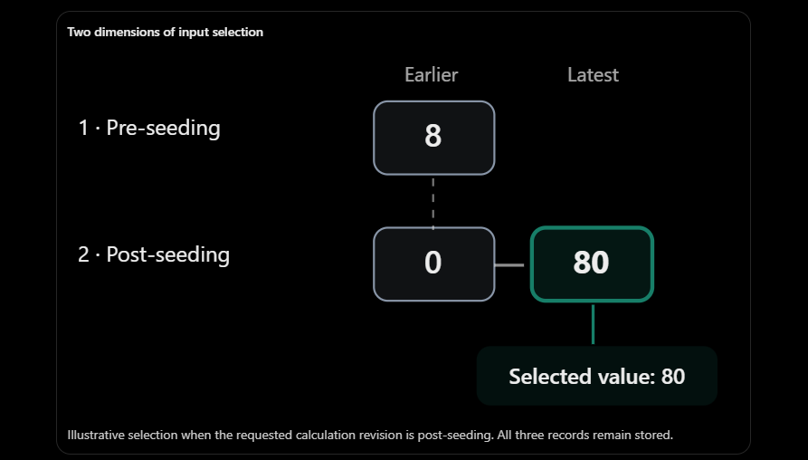
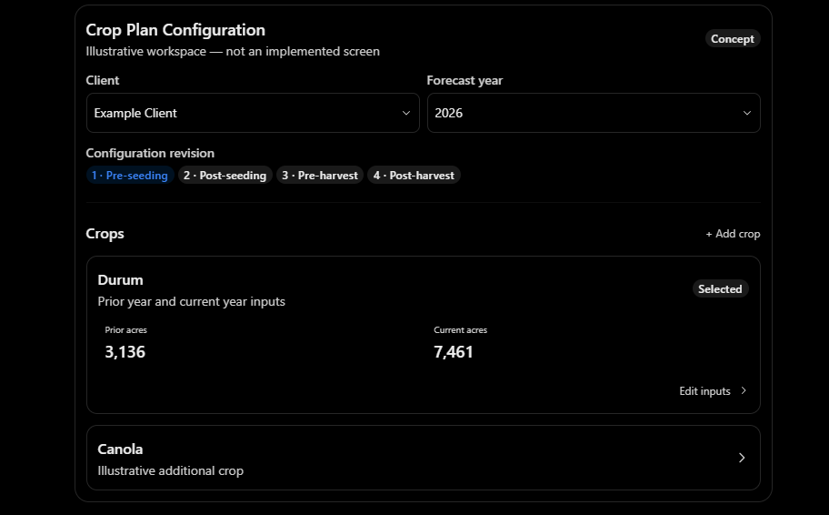
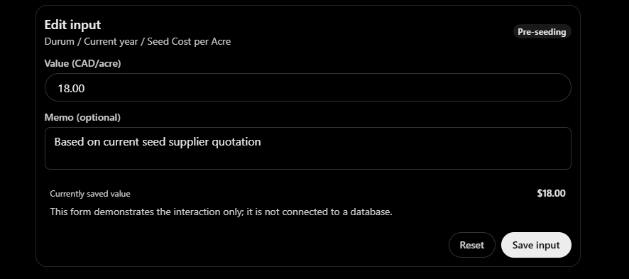
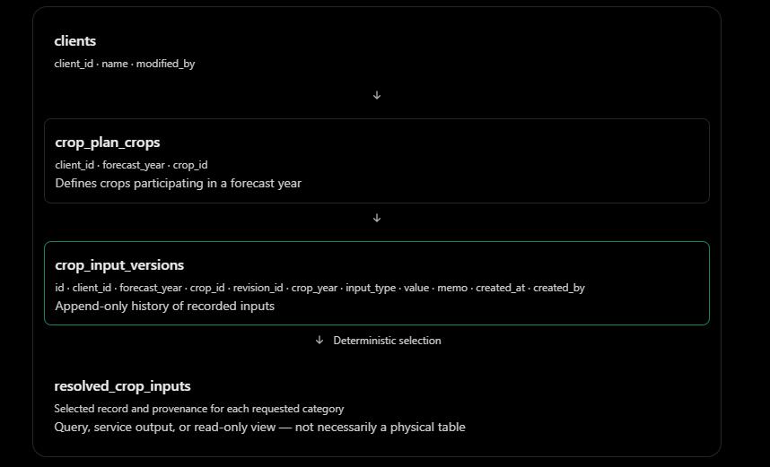
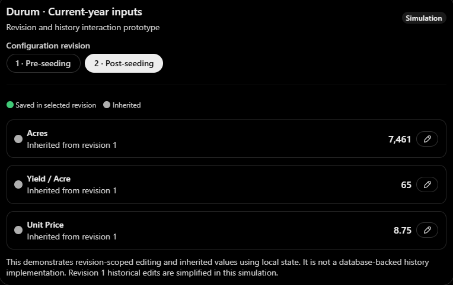
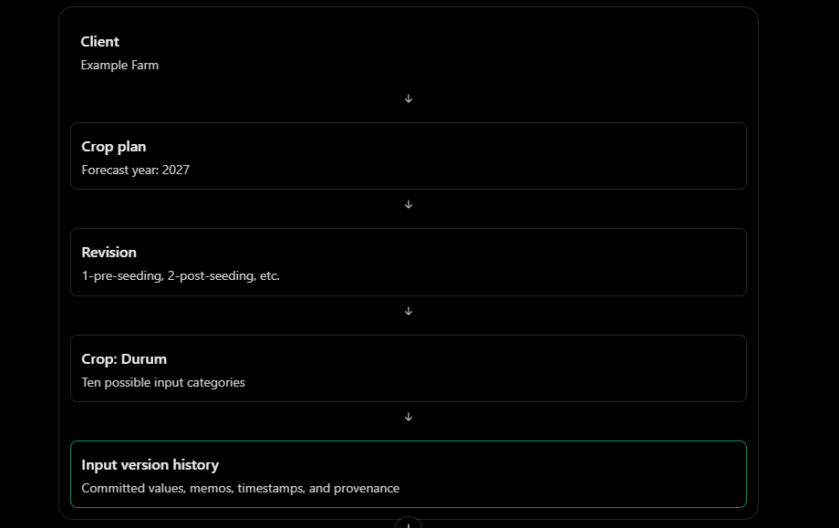
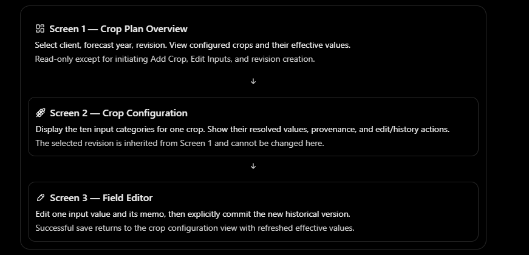
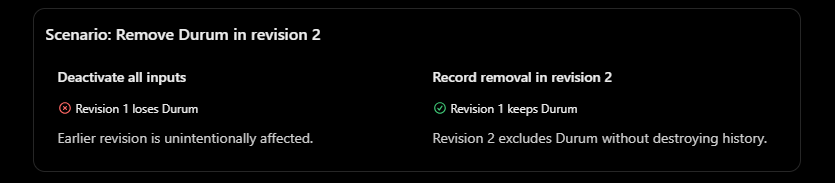
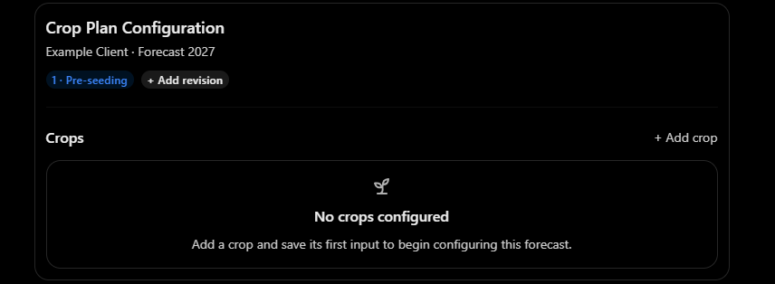

# Convo 1 - overall architecture

I think we have reached a very interesting architectural transition in the Growlytics platform.

The October experiments established a working foundation for managing entities reliably: explicit UI states, asynchronous request handling, HTTP contracts, database transactions, and automated regression tests. We can now use that foundation to build something much closer to the actual forecasting business.

But there is an important difference between the client portal and the crop plan configuration system:

Client management is primarily about maintaining the current state of an entity. Crop plan configuration is about maintaining a history of financial assumptions, across crops, forecast years, and revisions, while allowing the forecast engine to deterministically select the correct inputs.

That changes how I would approach both the React workflow and database architecture.

I would organize this discussion around three design layers, without committing to implementation prematurely:

1. User workflow: How someone selects a client, forecast year, revision, crop, and individual field, and how edits and memos work.
2. Data model: How we preserve historical values and memos while exposing one selected value per input category.
3. Revision resolution: How the forecast engine selects the appropriate input when multiple revisions and historical edits exist.

Then we can identify the engineering questions that deserve isolated experiments, just as we did throughout October.

## 1. The first distinction: editing an input versus selecting an input

Your Durum example already contains the most important design question.

Consider these three records:

| Revision       | Input            | Value | Modified |
| -------------- | ---------------- | ----- | -------- |
| 1-pre-seeding  | Prior Unit Price | 8     | Jan 1    |
| 2-post-seeding | Prior Unit Price | 0     | Jan 20   |
| 2-post-seeding | Prior Unit Price | 80    | Mar 30   |

There are two separate operations happening:

Operation A: Resolve revisions. For a post-seeding forecast, prefer the post-seeding input over the pre-seeding input.

Operation B: Resolve history within a revision. Since post-seeding has two values, use the latest one, 80, while preserving the earlier 0.

This suggests a two-dimensional model:



Illustrative selection when the requested calculation revision is post-seeding. All three records remain stored.

My preliminary recommendation is to make every saved input an immutable historical record, rather than updating its existing database row.

That means editing Durum's prior unit price from 0 to 80 should produce a new record. The previous record remains intact.

We can then build a read-only resolver that selects one record according to explicit rules. This fits your existing architectural principle that input configuration and forecast computation should remain separate.

## 2. React workflow: a crop plan workspace

I would avoid immediately translating your input spreadsheet into one enormous editable React table.

Instead, I suggest a workspace organized by context → crop → field → history.



This is only a conceptual structure. We can revisit its visual design after figuring out the behavior.

### A. Context selection

The user first selects:

- Client
- Forecast year
- Configuration revision (initially fixed to `1-pre-seeding` in our first prototype)

Once these are selected, the crop plan workspace becomes available.

I would treat this combination as the configuration context. Changing the context should load an entirely different dataset, and no unsaved draft should silently carry across contexts.

### B. Crop selection

Within that context, the user sees the crops involved in the forecast.

For each crop, we would have two sections:

| Prior year         | Current year     |
| ------------------ | ---------------- |
| Acres              | Acres            |
| Yield / Acre       | Yield / Acre     |
| Quantity Inventory | Unit Price       |
| Unit Price         | Seed Cost / Acre |
|                    | Fert Cost / Acre |
|                    | Chem Cost / Acre |
|                    | Fuel Cost / Acre |
|                    | Rent Cost / Acre |

That is 12 possible inputs per crop, exactly matching your current engine contract.

One particularly important requirement is that a crop might exist in the prior year without being planted in the current year. Such a crop might still have prior inventory that matters financially.

We should therefore avoid a design where disabling current-year planting hides or deletes the prior-year records.

### C. Field editing

Here I would reuse the philosophy from the client management experiments: explicit editing and explicit submission.

Imagine selecting Durum's current-year Seed Cost / Acre.



A successful save would append a new record, even if the field already has a saved value.

The UI would then display the newly selected value and allow the user to inspect earlier versions.

For a first prototype, I favor one-field-at-a-time editing because it gives us a bounded unit of work: one mutation, one API response, one integrity guarantee. It also avoids the complexity of tracking and committing dozens of unsaved fields simultaneously.

Later, we could introduce spreadsheet-like multi-field editing without changing the underlying storage contract.

## 3. Database architecture: separate identity from history

I would use a relational model with a distinction between crop identity, input definitions, and recorded values.

A conceptual structure might look like this:



Additional reference tables could hold the crop catalog, metric definitions, and revision definitions.

A sample historical input record could look like:

```
id:            105
client_id:     12
forecast_year: 2026
crop_id:       4
revision_id:   2
crop_year:     prior
input_type:    unit_price
value:         80.00
memo:          test-changed from 8 to 80
created_at:    2026-03-30T14:00:00Z
created_by:    user_1
```

The important design characteristics are:

Stable identifiers. `crop_id` should refer to a stable crop catalog entry. Renaming the display name from "Durum" to "Durum Wheat", for example, should not disrupt historical data.

Controlled input types. Rather than having unconstrained labels such as `"Yield / Acre"`, we should use stable machine-readable metric keys like `yield_per_acre`, then translate those keys into the labels the forecast engine currently expects.

Explicit revision ordering. Do not depend on alphabetically sorting `revision_name`. Use an ordinal such as 1, 2, 3, 4.

Immutable versions. The database should retain previous values, including their original memos. A new edit creates a new row.

Transaction boundaries. The input value, memo, author, and record timestamp should be committed atomically.

Selection must not depend solely on timestamps. Two writes can share a timestamp depending on resolution. We should include a monotonic record identifier to make tie-breaking deterministic.

One thing I would deliberately avoid is creating one column for each of the 12 metrics on the main crop record.

Your forecast engine already uses a category/value model, and each individual metric carries its own revision history and memo. A tall, versioned input table is a more natural fit.

## 4. Revision resolution: the most important contract

I would define the input identity as:

```
client_id
forecast_year
crop_id
crop_year
input_type
```

Then the revision and individual historical records are additional dimensions of that identity.

For a requested calculation revision, the resolver would:

1. Find records matching the input identity.
2. Exclude revisions newer than the requested revision.
3. Prefer the highest available revision.
4. Within that revision, prefer the most recent saved record.
5. Return its value, memo, and provenance.

For instance, suppose we have the following Durum current-year acres history:

| Revision     | Saved value | Sequence |
| ------------ | ----------- | -------- |
| Pre-seeding  | 7,461       | 101      |
| Pre-seeding  | 7,500       | 104      |
| Post-seeding | 7,600       | 109      |
| Pre-harvest  | 7,550       | 115      |

The resolver would produce:

| Requested revision | Selected acres |
| ------------------ | -------------- |
| Pre-seeding        | 7,500          |
| Post-seeding       | 7,600          |
| Pre-harvest        | 7,550          |
| Post-harvest       | 7,550          |

Notice the final row. Since there is no post-harvest record, the resolver inherits the latest record from the highest earlier revision.

And, importantly, the resolver runs independently for each input category. Durum's acres might come from pre-harvest while its fertilizer cost still comes from pre-seeding.

That matches the revision-selection behavior you described.

A conceptual SQL approach is:

```
SELECT *
FROM crop_input_versions
WHERE client_id = ?
  AND forecast_year = ?
  AND crop_id = ?
  AND crop_year = ?
  AND input_type = ?
  AND revision_order <= ?
ORDER BY
  revision_order DESC,
  id DESC
LIMIT 1;
```

This is illustrative rather than a finalized schema. In a normalized model, `revision_order` could come from a revision-definition table or join rather than being stored on each input version.

### A crucial additional decision: deletion versus inheritance

Suppose a user removes Durum's post-seeding Unit Price.

What should happen?

Under the simple resolver above, if the post-seeding record disappears, the forecast falls back to pre-seeding Unit Price.

But what if the user explicitly wants to say that the price is no longer available?

Those are different meanings.

We may eventually need an explicit marker such as `SET_VALUE` versus `CLEAR_VALUE`, where a clear action prevents unintended inheritance. That distinction becomes especially important for zero values and inputs that are intentionally absent.

I would document this as an unresolved design decision before implementation.

## 5. Five invariants I would want to establish early

These are candidates for the next round of regression tests.

| Invariant                | Expected guarantee                                                               |
| ------------------------ | -------------------------------------------------------------------------------- |
| Historical preservation  | Saving a replacement value does not delete the prior record or memo              |
| Revision isolation       | Editing post-seeding cannot change a pre-seeding calculation                     |
| Deterministic resolution | Identical stored history and requested revision produce the same selected values |
| Atomic mutation          | A value and its memo are committed together, or neither is                       |
| Explicit missing values  | Missing, zero, and intentionally cleared values have distinguishable meanings    |

There is also one subtle issue worth flagging: a forecast computation should resolve its inputs from a consistent database snapshot. Otherwise, concurrent edits could cause one computation to inadvertently combine values observed at different moments.

We do not need to build an elaborate orchestration system for the prototype. But defining this guarantee early could prevent a particularly difficult class of errors later.

## 6. How I would sequence the next experiments

I agree with your instinct to make `06-react-router-lab` the next experiment. It is a bounded concern that improves the architecture without immediately introducing the crop input complexity.

My proposed direction is:

| Experiment                   | Engineering question                                                          | Reusable outcome                            |
| ---------------------------- | ----------------------------------------------------------------------------- | ------------------------------------------- |
| 06 · React Router            | How do multiple configuration pages coexist without coupling their workflows? | Application shell, routing, navigation      |
| 07 · Crop Plan Domain        | How do we represent crops, metrics, and field-level drafts?                   | Crop plan UI and state contracts            |
| 08 · Versioned Input Storage | How do we preserve every input mutation reliably?                             | Append-only database and API services       |
| 09 · Revision Resolution     | How do we deterministically select inputs across revisions?                   | Tested resolver and forecast input contract |
| 10 · Crop Plan Integration   | How do React workflows safely operate against versioned input APIs?           | End-to-end functional crop plan prototype   |

These are provisional boundaries, not commitments. In particular, we might discover that revision resolution is easier to understand and test before introducing the complete React configuration UI.

And I would not implement all four revisions just because the schema supports them. We could launch the first working prototype using only `1-pre-seeding` while establishing a storage model that can later support additional revisions.

That is consistent with the simplification decision you reached with the Growlytics partners in October.

## 7. The three questions I think deserve our attention first

Before designing the UI in greater detail, I see three business-level decisions that materially affect the architecture.

First, what constitutes the crop plan's membership? A crop may appear in the prior year but not be planted in the current year. We should define whether its presence is explicitly managed or inferred from existing input records. I lean toward explicit crop membership so that having incomplete inputs does not make a crop disappear from the configuration screen.

Second, what does a revision represent operationally? Is selecting post-seeding equivalent to opening a new editing context where every field initially inherits pre-seeding values? Or does the user manually create a new independent revision? I prefer the former: inheritance is resolved dynamically, and only changed fields need new records.

Third, should history reflect every saved submission, or only changed values? For the initial version, I favor recording every successful explicit change, while treating an unchanged value-and-memo submission as a no-op. That keeps history useful without making it unnecessarily noisy.

### My overall architectural recommendation

I would preserve three boundaries throughout these experiments:

Configuration UI

Users manage crops, edit individual inputs, add memos, and inspect history.

Versioned input store

Preserves every committed historical version with explicit identity and provenance.

Revision resolver

Produces deterministic, read-only input values for the existing forecast computation engine.

I particularly like that the third layer can be tested entirely without React. We could construct dozens of synthetic histories in SQLite and verify selection across every supported revision, including duplicates, missing values, and fallback behavior. This gives us strong mathematical confidence in input resolution before integrating the UI.

There is one broader architectural issue I would keep in mind: historical input preservation is not necessarily the same as historical forecast reproducibility. If someone runs a pre-seeding calculation in January and reruns it in March after additional pre-seeding edits, the same revision name could resolve to different values. Eventually, we may need an explicit calculation snapshot or input cutoff to reproduce the January result. We should distinguish that requirement from the initial versioned configuration system rather than conflating the two.

For now, I think our highest-value next discussion is the conceptual data model and exact semantics of revisions, inheritance, missing values, and crop membership. Once those are settled, the React workflow will be much easier to design around well-defined operations.

And unlike October, we would not be inventing the reliability mechanisms from scratch. We already have a tested foundation to build upon.&#x20;

# Convo 2 - Revision & History

I think your proposed rules are moving us toward a very coherent configuration system. In particular, I like that you're defining the behavior of revision selection before defining database tables or React states.

There are two things I especially agree with:

1. The selected revision governs the entire editing context. Users cannot accidentally modify a different revision while working on the current one.
2. Prior-year inputs should have a single authoritative source. We should not independently maintain 2026 crop information in both the 2026 and 2027 forecast configurations.

However, I see three subtle issues worth resolving: how inherited values respond to changes in earlier revisions, how revisions interact across forecast years, and whether inventory is genuinely a calculated field.

I'll walk through your proposed behavior first.

## 1. Revision selection as the governing context

I agree with this design.

When a user first opens a crop plan, only `1-pre-seeding` exists. They can add `2-post-seeding`, which becomes selected automatically.

At this point, every field in revision 2 inherits its value from revision 1, unless it has explicitly been overridden in revision 2.

Here's a small interactive representation of how I envision this working.



Try creating revision 2, editing a value, and switching revisions.

The mechanics you're describing are intuitive. The selected revision controls editing, while the indicators explain where each displayed value came from.

One small semantic adjustment: green should mean that a value has an explicit record in the selected revision, rather than simply that it is current. Every displayed value is current for the requested calculation revision, even if inherited.

## 2. What happens when revision 1 changes after revision 2 exists?

This is the first major design decision.

Suppose we start with:

| Input      | Revision 1 | Revision 2 |
| ---------- | ---------- | ---------- |
| Acres      | 7,461      | Inherited  |
| Yield/Acre | 65         | 70         |
| Unit Price | 8.75       | Inherited  |

Now the user switches back to revision 1 and changes Acres to 7,500.

What should revision 2 display?

Under your existing forecast-engine resolution principle, it should display 7,500 immediately because revision 2 has no explicit Acres override.

Meanwhile, its Yield/Acre remains 70.

This is what I would call dynamic inheritance.

The alternative is copying all revision 1 values into revision 2 when the revision is created, but I would strongly discourage that. It creates unnecessary duplication and changes the meaning of inheritance.

My recommendation is:

Creating a revision creates the revision context, not copies of its predecessor's input records.

This also makes the database much cleaner.

There is one consequence to acknowledge: editing revision 1 can change the effective values in revision 2, 3, and 4 wherever they inherit that field. The UI should eventually make this dependency visible, particularly when editing an earlier revision.


## 4. Missing crops: your `—` rule is appropriate

I agree that a missing value should display as `—`, not zero.

Let's consider three cases.

| Situation          | Prior year | Current year    |
| ------------------ | ---------- | --------------- |
| Continuing crop    | Available  | Available       |
| Newly planted crop | —          | Entered by user |
| Discontinued crop  | Available  | —               |

This is a useful presentation rule, and we should preserve the underlying semantic distinction.

For a newly planted crop, the missing prior-year values mean there was no corresponding historical crop record to inherit.

For a discontinued crop, current-year values may be inapplicable because the client is not planting that crop.

However, an input that is applicable but hasn't yet been entered is also potentially `—` on screen.

Those two situations are not necessarily equivalent for forecasting completeness.

For the first prototype, a blank value can be displayed consistently, but the underlying model should eventually distinguish:

- Not applicable
- Missing required input
- Explicit numeric zero

Otherwise, the forecast engine may have difficulty deciding whether a crop configuration is complete enough to run.

I particularly agree with your decision to defer the forecast completeness checks. They are related to input configuration, but they deserve their own rules and tests rather than being mixed into the history model.


## 6. An important distinction between historical visibility and historical existence

I like your idea that overwritten history is only visible for the selected revision, and that inherited inputs shouldn't display an editing history for a revision where no changes have occurred.

But I would make one small refinement.

Suppose revision 2 inherits Durum Acres from revision 1.

The interface could display:


You might still want a way to inspect the source value's history, even though revision 2 itself has no history.

So I would distinguish:

Revision-local history: Every committed version of a field within the selected revision.

Source provenance: The revision and historical record from which an inherited value was resolved.

They serve different purposes. History explains what changed within a revision; provenance explains why the current displayed value exists.

We can keep the initial UI simple by hiding the detailed source history behind a secondary action.

## 7. The resulting mechanics

Here is the model I would tentatively adopt.

| Event                         | System behavior                                                                            |
| ----------------------------- | ------------------------------------------------------------------------------------------ |
| Create revision 2             | Creates revision context, selects it, inherits all available values                        |
| Edit field in revision 2      | Appends a new revision 2 record, leaving revision 1 unchanged                              |
| Edit field in revision 1      | Appends a revision 1 record; later revisions without an override inherit the updated value |
| Select an earlier revision    | Displays only values eligible for that revision                                            |
| View field history            | Shows committed records belonging to selected revision                                     |
| View inherited field          | Displays source revision and value; no revision-local edit history                         |
| Open forecast year 2027       | Prior-year fields resolve from authoritative 2026 current-year inputs                      |
| Edit prior-year field in 2027 | Not permitted; user navigates to the 2026 source                                           |
| No applicable crop value      | Displays `—`, with missingness semantics retained internally                               |

One more important rule I would include: creating a revision should be explicit and singular. If revision 2 already exists for the selected client and forecast year, clicking Add Revision should never create another revision 2.

Likewise, field changes should be atomic append-only operations, not updates that overwrite existing records.

# Convo 2.1 - resolve architecture & proposing next convo

😁 I think that discovery just eliminated a surprisingly large amount of unnecessary complexity!

We were about to design cross-year inheritance, determine which previous-year revision was authoritative, handle propagation across forecast years, and potentially introduce historical snapshots to keep those dependencies stable.

And then you examined the actual computation contract and discovered that none of that was necessary.

That's exactly the kind of discovery we want during architectural brainstorming, rather than halfway through implementation.

More importantly, I think we now have a sufficiently coherent revision model to move on. I would not spend another week perfecting its edge cases before exploring the next architectural boundary.

## 1. Let's consolidate what we have established

The crop plan now has ten editable input categories per crop.

| Period       | Input categories                                                                                              | Behavior                                              |
| ------------ | ------------------------------------------------------------------------------------------------------------- | ----------------------------------------------------- |
| Prior year   | Quantity Inventory, Unit Price                                                                                | Editable within the selected forecast year's revision |
| Current year | Acres, Yield/Acre, Unit Price, Seed Cost/Acre, Fert Cost/Acre, Chem Cost/Acre, Fuel Cost/Acre, Rent Cost/Acre | Editable within the selected forecast year's revision |

We have eliminated prior-year Acres and Yield/Acre entirely.

For each category, revision resolution follows one rule:

Select the most recent committed record from the highest available revision that does not exceed the selected revision.

Every displayed value should carry provenance, allowing the UI to distinguish an explicit value in the selected revision from one inherited from an earlier revision.

The resulting configuration identity is:

```
client_id
forecast_year
crop_id
crop_year
input_type
```

Each stored input version additionally has a revision, a value, a memo, a timestamp, and a unique record ID.

I would keep the following conceptual distinction:

- A revision is an editing and resolution context.
- A historical version is one committed edit to an individual field within that revision.
- An effective value is the result of resolving the available historical versions for a selected revision.

These three concepts should stay distinct in both backend code and React state.

## 2. The next topic I propose: the identity and lifecycle of a crop plan

Before we design database tables or individual endpoints, I would address something more fundamental:

What exactly exists in the system before somebody enters the first crop input?

It sounds like a small question, but it governs nearly every subsequent implementation decision.

Consider the hierarchy:



This is a conceptual hierarchy, not necessarily a one-to-one database table hierarchy.

For example, revisions belong to a client and forecast year, while a crop's historical input records merely reference those revisions. We don't want to duplicate revision definitions separately for every crop.

There are three questions within this topic.

### A. Does a crop plan explicitly exist?

Suppose a user selects Client A and forecast year 2027 for the first time.

Should the system automatically create a crop plan, or should the user explicitly click Create Crop Plan?

I lean toward explicit creation.

That establishes a clean lifecycle boundary between a forecast year with no configuration and one in which configuration has begun.

It also gives us a natural place to initialize revision 1.

### B. Does a crop exist independently of its inputs?

Suppose Durum is added to the 2027 crop plan, but no input values have been committed yet.

Should Durum still appear?

I strongly favor yes.

Otherwise, the crop's presence becomes dependent on whether at least one input record exists.

That creates unnecessary coupling between crop management and input management. It also makes missing-input detection more difficult.

We could support an explicit crop membership record:

```
crop_plan_id
crop_id
```

This says only that Durum belongs to this crop plan. It says nothing about whether all ten inputs exist.

There is a subtle revision question here as well: if a crop is added in revision 2, should it appear when someone returns to revision 1?

My preference is that crop membership should eventually follow the same revision-aware model as field values. Otherwise, a new crop created after seeding could appear retroactively in the pre-seeding configuration.

But we should make that decision explicitly rather than accidentally inheriting behavior from our database design.

### C. What does removing a crop mean?

Suppose Durum has a prior-year inventory quantity of 100,000 BU but no current-year planting.

We should not remove Durum simply because the client isn't planting it.

It still contributes to liquidation potential.

Therefore, I suggest treating these as different operations:

- Not planting this year: Durum remains in the crop plan; current-year planting inputs may be inapplicable.
- Removing Durum from the crop plan: Durum no longer participates in the selected revision's forecast, regardless of its historical input values.

Because we are preserving input history, removal probably shouldn't physically delete historical records.

That points toward a future revision-aware membership or activation model.

## 3. What this means for our experimental roadmap

I would keep the next labs narrowly scoped.

| Lab                          | Central engineering question                                                           |
| ---------------------------- | -------------------------------------------------------------------------------------- |
| `06-react-router-lab`        | How do we navigate between independent configuration pages?                            |
| `07-crop-plan-lifecycle-lab` | How are crop plans created, crops added, and revisions established?                    |
| `08-input-versioning-lab`    | How do append-only edits preserve history and ensure transaction integrity?            |
| `09-revision-resolution-lab` | How do we dynamically resolve inherited values and expose their provenance?            |
| `10-input-history-ui-lab`    | How does React reliably display effective values and revision-local committed history? |

The exact numbering can change as we learn.

In fact, I would probably investigate revision resolution using a small SQLite/Python experiment before building its full UI, because we can test its semantics independently and establish a reliable backend contract.

One helpful architectural principle is that we should not need a separate database table containing inherited values.

For example, when revision 2 inherits Durum's current-year Acres from revision 1, the resolver could return something like:

```
{
  "requested_revision": "2-post-seeding",
  "source_revision": "1-pre-seeding",
  "input_type": "acres",
  "value": 7461,
  "memo": "Initial acreage estimate",
  "version_id": 101,
  "is_inherited": true
}
```

This is a calculated response, not another stored input record.

The UI can obtain both the effective value and the provenance from a single read operation.

We could separately provide a history endpoint that retrieves committed versions within the selected revision.

This means dynamic inheritance and provenance are primarily resolver responsibilities, while history display is primarily a read-query and frontend presentation concern.

That separation will make the experiments much easier to reason about.

## 4. The first decision I would tackle

Before proceeding with the crop plan lifecycle, I would like to establish one policy:

Suppose we're editing the 2027 forecast.

Revision 1 contains Durum and Canola.

Revision 2 is created, inheriting both.

Then the user adds Lentils in revision 2.

What should happen when they switch back to revision 1?

How should crop membership behave across revisions?

Revision-aware membership

Lentils appears in revision 2 and later, but not revision 1.

Forecast-year-wide membership

Lentils appears in every revision, including revision 1, but without earlier input values.

Illustrative resulting crop visibility

| Revision         | Visible crops          |
| ---------------- | ---------------------- |
| 1 · Pre-seeding  | Durum, Canola          |
| 2 · Post-seeding | Durum, Canola, Lentils |

Explore this policy&#x20;

My recommendation is revision-aware membership, because a revision should represent a coherent view of the crop plan at a particular stage of the forecasting process.

This would let us treat adding or removing a crop similarly to overriding an input: it changes the current revision without retroactively changing earlier ones.

But it also introduces a useful new engineering problem: crop membership has its own inheritance and history semantics, distinct from numeric field values.

That's where I would focus our next discussion. Once we define the crop plan lifecycle and crop membership, I think the database architecture will begin to reveal itself quite naturally, without prematurely designing tables that we later have to undo.

# Convo 3 - identity and lifecycle of a crop plan

Ahhh, now I understand your intended workflow much better! 😁

And I think you're right to question my proposal for explicit crop membership. Given the workflow you've described, we may not need a separate crop membership table at all for the initial prototype.

My previous suggestion assumed that adding a crop was itself a committed business operation. Your design is different: adding a crop merely begins a configuration workflow, and the first successfully saved input is what establishes the crop's existence in the database.

That is a meaningful simplification.

However, I would distinguish two questions:

1. Do we need a separate table representing crop membership?
2. Do we need a reliable way to determine whether a crop belongs to a particular revision?

The answer to the first might be no. The answer to the second is definitely yes.

Let me explain using your three screenshots.

## 1. The three-screen workflow is a good foundation

Your proposed architecture has three levels of interaction.



I particularly like that revision selection occurs only at the overview level. This reduces the number of states the field editor needs to handle.

In fact, I would treat the client, forecast year, and revision as a fixed configuration context throughout the crop-editing workflow.

### What happens when the user adds their first crop?

Your desired lifecycle is clear:

1. User opens Client A / Forecast 2027 / Revision 1. No crops exist.
2. User clicks + Add Crop, selects Durum, and enters the crop configuration screen.
3. All ten fields display `—`. No database records have been created.
4. User begins editing Acres but cancels. The unsaved draft remains in React memory, and the overview still shows no crops.
5. User returns to Durum and successfully commits Acres = 7,461. A historical input record is inserted.
6. Durum now appears on the overview, with Acres = 7,461 and the other nine values displayed as `—`.

One implementation detail: preserving drafts across navigation requires the draft state to live somewhere that survives the editor component unmounting. It could be lifted to the crop workspace level or managed through a small draft-state context.

We don't need local storage or a draft database for this first iteration.

And since you're intentionally postponing input-completeness requirements, the backend's job at this stage is to record valid submitted input values, not determine whether the entire crop plan is suitable for forecasting.

That is a good separation.

## 2. Why I originally suggested explicit crop membership

Let's consider a concrete example.

Suppose your input history table contains:

| ID  | Revision | Crop  | Input      | Value | Active |
| --- | -------- | ----- | ---------- | ----- | ------ |
| 101 | 1        | Durum | Acres      | 7,461 | True   |
| 102 | 1        | Durum | Yield/Acre | 65    | True   |
| 103 | 2        | Durum | Acres      | 7,500 | True   |

To display the crops in revision 2, we can simply find the distinct crops with effective inputs available up to revision 2.

Durum qualifies because revision 1 has records that revision 2 inherits.

So far, no membership table is necessary.

Now imagine the user removes Durum from revision 2.

You proposed setting all relevant input records to `active=FALSE`.

The problem is determining which records should become inactive.

If we deactivate IDs 101 and 102, Durum will also disappear from revision 1, even though those records were created there.

That violates our revision isolation rule.

If we deactivate only ID 103, Durum still appears in revision 2, because it continues inheriting IDs 101 and 102.

This is the architectural problem that explicit membership solves.

### Compare the two approaches



There is a second problem: what happens if the user subsequently wants to restore Durum?

If we physically modify the `active` flag on all historical records, we've changed the original history. We no longer know which inputs were originally committed and active at a particular revision.

That conflicts with our append-only design.

## 3. My revised recommendation: implicit creation, explicit removal

I think we can combine your workflow with revision-aware crop membership without introducing a complicated membership management system.

Creation remains implicit. The first committed input establishes a crop's presence.

Removal becomes an explicit, versioned crop-level event. It does not modify existing input records.

Consider a conceptual table:

`crop_presence_events`

| ID  | Client | Year | Crop  | Revision | Action  |
| --- | ------ | ---- | ----- | -------- | ------- |
| 201 | A      | 2027 | Durum | 1        | ADD     |
| 202 | A      | 2027 | Durum | 2        | REMOVE  |
| 203 | A      | 2027 | Durum | 3        | RESTORE |

Here, event 201 could be created automatically in the same database transaction as the first successfully saved input.

The distinction is important: the user does not need to explicitly manage membership, even though the backend records crop lifecycle information.

This would produce:

| Revision       | Durum visible? | Explanation                            |
| -------------- | -------------- | -------------------------------------- |
| 1-pre-seeding  | Yes            | First committed input establishes crop |
| 2-post-seeding | No             | Explicit removal event                 |
| 3-pre-harvest  | Yes            | Restore event                          |

All original input history remains untouched.

And creating revision 2 itself does not generate duplicate input rows or duplicate crop presence events.

We could also avoid the `ADD` event initially by inferring initial membership from the earliest saved input, and only recording removal/restoration events. But I slightly prefer explicit lifecycle events because the resulting logic is easier to inspect and test.

A small database table for lifecycle events isn't necessarily overengineering if it prevents an entire class of inconsistent historical behavior.

## 4. There is one alternative if we want an even simpler V1

We could decide that removing a crop applies to the entire forecast year, across all revisions.

Under this policy, an `active` flag on the crop itself might be sufficient.

For example:

```
client_id:     12
forecast_year: 2027
crop_id:       4
active:        false
```

But then removing Durum while viewing revision 2 would also remove it from revision 1's presentation.

We would be deliberately sacrificing historical revision isolation for crop membership.

I don't think that matches your overall revision design, so I wouldn't recommend it.

The important point is that a single boolean `active` cannot represent different crop-presence states across multiple revisions. We need some representation of when the crop becomes absent.

## 5. One more issue: editing a field shouldn't create duplicate crops

Suppose Durum has already been created in revision 1 and is inherited into revision 2.

The user edits revision 2 Acres.

We should insert only a new input version. We should not create another crop-presence event merely because another input was committed.

This gives us a useful operational contract:

| Operation                        | Database effect                                 |
| -------------------------------- | ----------------------------------------------- |
| First saved input for a new crop | Create crop presence + input version atomically |
| Subsequent saved input           | Append input version                            |
| First revision 2 override        | Append input version; no new membership         |
| Remove crop in revision 2        | Append REMOVE event                             |
| Restore crop in revision 3       | Append RESTORE event                            |
| Cancel Add Crop                  | No database effect                              |

This contract can be tested quite directly in SQLite.

There is one further edge case to defer: what happens if users remove and later restore a crop within the same revision? I would lean toward restoring its previous input values, rather than deleting or resetting them, but we should define that behavior before implementing removal.

## 6. The one architectural change I would make to your UI

I would keep your three screenshots almost exactly as they are.

The only change I would make to the first screenshot is to display a useful empty state when no crops are configured.

## Crop Plan Configuration



I would not introduce a separate "Create Crop Plan" button. Your workflow already gives us a more natural creation boundary through the first committed input.

The only caveat is that revision creation must be persisted independently. Otherwise, a revision 2 with no inputs would disappear after refresh.

## Where I think we've arrived

I would now propose the following principles:

1. The overview is a presentation screen. It displays effective crop inputs for one client, forecast year, and revision.
2. Add Crop initiates an uncommitted workflow. Cancelling leaves no database records.
3. The first committed input establishes the crop's presence.
4. All fields are individually editable, with committed history and revision provenance.
5. Revision inheritance is dynamic, with no copied input records.
6. Crop removal is a revision-scoped lifecycle event, not a mass update to historical input records.
7. Historical input rows remain immutable.

I think this is a fairly elegant compromise between your desire to minimize infrastructure and the need for historical correctness.

### What I would discuss next

We've now reached a point where the next architectural question is not really about React.

It's about how to represent crop existence and revision history in the database without unnecessary duplication.

I suggest we take one concrete sequence of actions—create Durum in revision 1, create revision 2, modify Acres, remove Durum, return to revision 1, and restore Durum—and walk through exactly what rows are inserted and what the resolver returns at every step.

That would expose whether the proposed lifecycle events are genuinely necessary, or whether an even simpler schema can satisfy all the invariants.

And importantly, it would give us a precise, testable foundation for the next SQLite experiment before we start wiring the React screens.